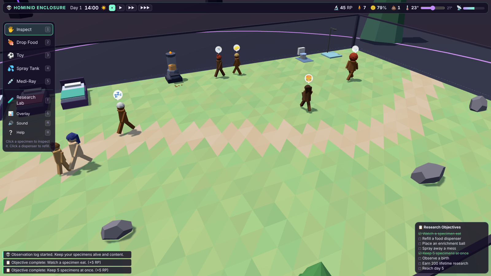

_They wander. They nap. They make messes._

**[▶ Play Hominid Enclosure in your browser](/play/hominid-enclosure/)**

---

## About the Game

**Hominid Enclosure** flips the life sim around. You are the alien keeper of a glass terrarium full of *Homo sapiens*, and the Galactic Zoological Society expects results.
Specimens think for themselves: they get hungry, sleepy, lonely, bored and grubby, then decide what to do about it.
Your job is to keep the dispensers full, the floor clean and the mood high. Happy specimens generate research, and research buys a bigger, better enclosure.

## Core Loop

- Watch your humans live their lives with a free-range 3D camera.
- Refill food dispensers before anyone goes hungry.
- Clean up the inevitable messes (and hose down the smelly ones).
- Spend research on beds, toilets, showers, toys, drones and upgrades.
- Keep everyone healthy, or the Galactic Welfare Bureau confiscates them.

## Features

- **Utility AI:** each human scores every action from their needs and personality traits, then picks the best one.
- **Six needs:** hunger, energy, bladder, hygiene, social and fun, plus mood, health and moodlets.
- **Social layer:** humans seek each other out, chat, build relationships and sometimes start families.
- **Hygiene and decay:** accidents, crumbs and illness spread when the enclosure gets dirty.
- **Alien tools:** drop food, place toys, use the spray tank, and fire the Medi-Ray.
- **Traits:** Lazy, Social, Clean Freak, Glutton, Playful and Hardy.
- **Environment:** a day/night cycle, a thermostat, and events like solar flares, coolant leaks, spore drifts and meteor showers.
- **Research lab:** unlock upgrades with research earned from happy, well-observed specimens.

## Controls

| Input | Action |
| --- | --- |
| Left-drag / right-drag / wheel | Orbit / pan / zoom |
| `W` `A` `S` `D`, `Q` `E` | Pan and rotate the camera |
| `1`–`5` | Inspect, Drop Food, Toy, Spray Tank, Medi-Ray |
| `T` | Research Lab |
| `F` | Follow the selected human |
| `Space`, `,` `.` `/` | Pause and game speed |
| `G` | Needs debug overlay |

## Screenshots

## Tech

Built with [Three.js](https://threejs.org/) as a single static page: no build step, grid A* pathfinding, and procedural
low-poly characters with no faces or clothes, just hair and the occasional hat. Sound effects are synthesized live with the Web Audio API.

## Links

- [Play in the browser](/play/hominid-enclosure/)
